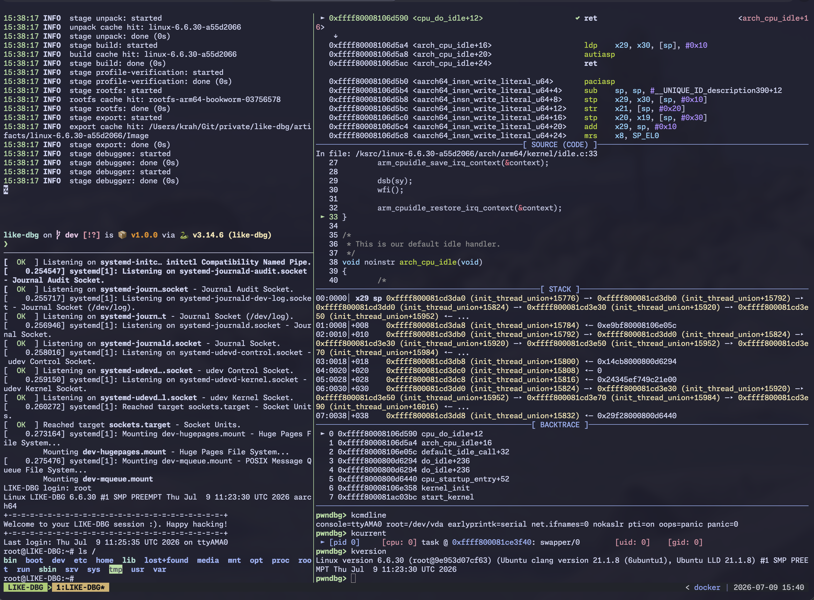

# LIKE-DBG

[](https://github.com/psf/black)
[](https://github.com/0xricksanchez/like-dbg/actions?query=workflow%3Aflake8)
[](https://github.com/0xricksanchez/like-dbg/actions?query=workflow%3Ashellcheck)
[](https://github.com/0xricksanchez/like-dbg/actions?query=workflow%3Ahadolint)
[](https://codecov.io/gh/0xricksanchez/like-dbg)
[](https://tldrlegal.com/license/mit-license)
[](https://github.com/0xricksanchez/like-dbg/releases/)

LIKE-DBG (*LI*nux-*KE*rnel-*D*e*B*u*G*ger) aims at automating the boring steps when trying to set up a Linux kernel debugging environment.
I set out to dive into kernel exploitation research and found existing solutions not usable enough.
Hence, this is an attempt at making all necessary pre-steps before one can even think about diving into research as painless and fun as possible.
All steps from building a kernel, running it inside an emulated environment, and attaching a debugger are transparently done inside docker containers to keep system requirements minimal.
Currently, there's a dedicated docker container for every of the following steps:

- Building the kernel
- Creating a root file system to use with the kernel
- Launching the kernel + file system as the _debuggee_
- Attaching to the kernel as a _debugger_

## Caveats

As this project is in its early stages, I expect things to change rapidly, while also introducing breaking changes along the way.
Major points to improve on are:

- Getting towards true multi-architecture support beyond `x86_64` and `arm64`
- Extend kernel builder to not only succeed in building recent™ kernels
- Add android kernel support
- Add (integration) tests
- Elevate the debugging experience even more

## Features

On the upside, despite its early stages, a couple of useful features are already present:

- General:
  - Minimal host system requirements due to dockerization of every step
  - An easy to grasp `configs/user.ini` config that allows highly customizable sessions
    - Or provide different configurations for different debugging setups via the command-line!
  - CTF runner that's specifically designed to handle Linux kernel exploitation challenges
    - `ctf/misc` that houses some nifty scripts to aid in CTFs
  - Code quality measures:
    - [black](https://github.com/psf/black) formatter for python code
    - [flake8](https://github.com/PyCQA/flake8) linter for all python code
    - [shellcheck](https://github.com/koalaman/shellcheck) linter for shell scripts
    - [hadolint](https://github.com/hadolint/hadolint) linter for the Dockerfiles
  - Operating system agnostic, meaning it should run just fine on:
    - Debian/Ubuntu
    - Arch Linux/Manjaro
    - Fedora
- Kernel builder:
  - Multi-arch: `x86_64`, `arm64`
  - Choose between `gcc` and `clang` to build the kernel
  - Configuration modes:
    - generic-mode,
    - syzkaller-mode,
    - custom-mode, or
    - provide a usable kernel config
  - Fine-granular version control to build from:
    - Commit hash
    - Release tag (e.g.: 5.10-rc)
    - Major-Minor-Patch (e.g.: 5.10.77)
  - Ability to automatically apply patch files
  - Basic ability to add custom kernel modules
- Root file system builder:
  - Powered by [debootstrap](https://wiki.debian.org/Debootstrap)
  - Automatic generation of file system that matches the kernels architecture
  - Ability to customize:
    - wanted packages in the file system
    - the Debian release version to base everything on
- Debuggee:
  - Powered by [QEMU](https://github.com/qemu/qemu)
  - Customization of QEMU runtime options from within the `configs/*.ini` files.
- Debugger:
  - Powered by [GDB (multiarch)](https://sourceware.org/gdb/) with either
    - [GEF](https://github.com/hugsy/gef) and [GEF-extras](https://github.com/hugsy/gef-extras), or
    - [pwndbg](https://github.com/pwndbg/pwndbg)
  - Allow users to specify GDB script in `io/scripts/gdb_script` to allow a scenario-tailored debugging experience

## Requirements

To get started, you have to ensure to have the following requirements set up in your system:

- `docker`
- `tmux`
- `python>=3.12`
- `uv` # <https://docs.astral.sh/uv/>

It is recommended to not run this as the `root` user, e.g. for testing purposes on a VPS.
It may work fine but in general I highly encourage creating a dedicated non-root user to put in the `docker` and `sudo` group!

### Optional

This section covers tools that are _not_ required to run LIKE-DBG but are nice to have and assist heavily when debugging or writing an exploit.

- [musl-gcc](https://www.musl-libc.org/how.html)
- [ctags](https://github.com/universal-ctags/ctags)
- [ropr](https://github.com/Ben-Lichtman/ropr)

## Setup

Inside `like-dbg` run `uv sync`

## Configuration

Fine-tuning the kernel debugging experience is one of the goals of this project.
Currently, all tunable options are exposed in the two configuration files: `configs/system.ini` and `configs/user.ini`.
Some fields are recommended to not be altered as they're mainly for development reasons.
However, all the ones to customize the environment to your needs should be self-explanatory as all of them are labeled with a brief comment.

## Usage

**Note:** On first time usage run `uv sync`.

Once you're set with writing/adapting a configuration, the usage depends on your scenario.
The easiest way to get started, which is based on the `configs/user.ini` configuration is the following:

```sh
tmux -L likedbg -f .tmux.conf new -s LIKE-DBG
```

Then inside that tmux session:

```sh
# This checks out a kernel, builds it, creates a root file system and starts the debugger and debuggee eventually
uv run ./start_kgdb
```

The `-L likedbg` socket name makes tmux start an isolated project server, so
the checked-in `.tmux.conf` is definitely loaded. If you intentionally run
LIKE-DBG inside an existing tmux server, load the project config into that
server first:

```sh
tmux source-file "$PWD/.tmux.conf"
```

The project tmux config binds `C-b B` to restart the Debuggee pane in place. If
you use a custom tmux config, keep an equivalent fallback binding or run:

```sh
uv run ./start_kgdb --restart-debuggee
```

There exist 2 users for the automatically created filesystems:

- `root` with no password
- `user`:`user`

This is intended so you can develop and exploit from either perspective easily.

### Extended Usage

```sh
# If you want to provide a custom 'user.ini' for a specific debugging setup
uv run ./start_kgdb -c <path_to_cfg> [other_args]

# Rebuild all LIKE-DBG container images
uv run ./start_kgdb --build-images

# List cached Kernel Builds and rootfs images
uv run ./start_kgdb --list

# Remove one cached artifact, or clear the cache
uv run ./start_kgdb --clean <label>
uv run ./start_kgdb --clean-all

# Reuse an existing Kernel Build, optionally with a specific rootfs image
uv run ./start_kgdb --use <build-label>
uv run ./start_kgdb --use <build-label> --rootfs <rootfs-label>

# Force the current Kernel Build to rebuild
uv run ./start_kgdb --force-rebuild

# Restart the Debuggee pane from stored tmux session state
uv run ./start_kgdb --restart-debuggee
```

### Examples

The `examples` subdirectory houses samples on how `LIKE_DBG` may aid you in specific kernel debugging tasks.
Each example contains a dedicated `README.md` as well that contains the necessary information to reproduce the examples.

## Showcase



## Hacking

The python code should be quite readable, so feel free to extend the project with your own ideas. All PRs are very much welcome :)!
Otherwise, feel free to create a feature-request issue or head over to the [discussions page](https://github.com/0xricksanchez/like-dbg/discussions) to brainstorm some cool new features!

PS: If you want to provide a logo, feel free to do so.
