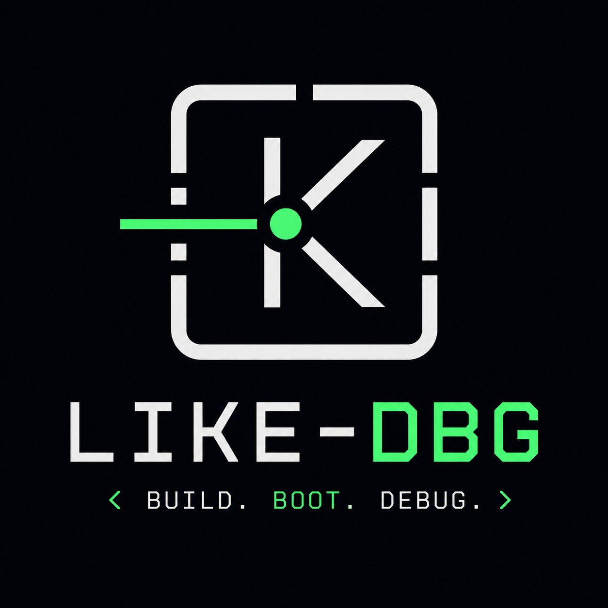

<p align="center">
  
</p>

# LIKE-DBG

[](https://tldrlegal.com/license/mit-license)
[](https://www.python.org/)
[](https://github.com/astral-sh/ruff)
[](https://mypy-lang.org/)

LIKE-DBG (**LI**nux-**KE**rnel-**D**e**B**u**G**ger) is a fully containerized Linux kernel
debugging and exploitation lab. It builds or adopts a kernel and root filesystem, boots them
under QEMU, and drops you into an interactive GDB session (pwndbg or GEF), wiring every piece
into a single tmux window.

The point is to remove the boring setup so your time goes to the kernel, not the scaffolding.
Every step runs inside Docker, so the only things you install on the host are Docker, tmux,
Python, and [uv](https://docs.astral.sh/uv/). Pick a kernel version (or hand it a CTF
challenge), run one command, and land at `start_kernel` with full symbols.

## What it does

One command resolves your config, builds or reuses a kernel and rootfs, boots the guest, and
attaches the debugger:

```sh
uv run ./start_kgdb
```

The run is a loop you stay inside: build or adopt a kernel and rootfs, boot it under QEMU (the
Debuggee), attach GDB (the Debugger), then edit, deliver, run, crash, root-cause, and repeat.

There are two ways to get a kernel:

- **Build your own.** Choose a version, a debug profile, and a compiler; LIKE-DBG downloads,
  configures, and builds it once, then caches it. This is the daily driver for kernel study and
  exploit development. See [docs/build-your-own-kernel.md](docs/build-your-own-kernel.md).
- **Bring a CTF or foreign kernel.** Hand it a challenge's `bzImage`/`Image` (plus `vmlinux`
  and `initramfs` if you have them) and it boots that verbatim under GDB. See
  [docs/ctf-foreign-kernel.md](docs/ctf-foreign-kernel.md).

## Highlights

- **Runs on macOS and Linux, host auto-detected.** Apple Silicon boots arm64 guests with native
  HVF acceleration; x86_64-on-Mac and Linux without KVM fall back to in-container TCG; Linux with
  KVM uses it. Storage, acceleration, and networking are chosen per host and recorded per run.
- **Architectures: x86_64 and arm64.**
- **TOML config with debug profiles.** A layered TOML stack (project defaults, personal local
  overrides, named scenarios, CLI) plus named profiles (`exploit-dev`, `hardened`, `kasan`,
  `ubsan`, `lockdep`, and more) that resolve to kernel config fragments and runtime defaults.
  Post-build `.config` verification catches a profile that did not take. Note that `exploit-dev`
  (the default) only turns KASLR off; SMEP, SMAP, and KPTI stay on unless you switch profiles or
  toggle them yourself (see [docs/configuration.md](docs/configuration.md#debuggee)).
- **Modern debugger.** Kernel runs default to pwndbg for its kernel command set (KASLR base,
  slab, `current`, task and module walking, symbol lookup); GEF is a one-line switch.
- **Exploit-dev inner loop.** `--run` and `--upload` deliver an exploit to the live guest over a
  9p share or SSH. A single flag-less `.c` is auto-compiled static-musl to the target arch;
  anything else is delivered as-is. See [exploit/README.md](exploit/README.md).
- **Custom modules.** Build out-of-tree modules against the running kernel and load them on
  command with `--insmod` and `--rmmod`; their symbols auto-load in GDB. See
  [modules/README.md](modules/README.md).
- **Crash intelligence.** A byte-exact serial console sink, a panic/oops/KASAN/UBSAN parser, and
  an auto-break that traps GDB at the fault with a symbolized backtrace. `--analyze-crash`
  regenerates a report offline.
- **Run artifacts.** Every session writes a timestamped `artifacts/runs/<id>/` with resolved
  settings, host profile, command records, logs, and pane transcripts.

## Requirements

- Docker
- tmux
- Python 3.12 or newer
- [uv](https://docs.astral.sh/uv/)

Run as a non-root user in the `docker` group. Cross-compilation and initramfs work happen inside
containers (a `zig cc` musl toolchain), so no host cross-toolchain is needed.

## Quickstart

```sh
# 1. Install dependencies
uv sync

# 2. Start the project tmux server (loads the shipped .tmux.conf)
tmux -L likedbg -f .tmux.conf new -s LIKE-DBG

# 3. Inside that tmux session: build-or-reuse a kernel, boot it, attach the debugger
uv run ./start_kgdb
```

The first run builds the container images and a kernel, so it takes a while; later runs reuse
the cache and start in seconds. Detach with `C-b d` and reattach with
`tmux -L likedbg attach -t LIKE-DBG`.

From here, read [docs/build-your-own-kernel.md](docs/build-your-own-kernel.md) for the full
workflow, or [docs/ctf-foreign-kernel.md](docs/ctf-foreign-kernel.md) if you have a challenge to
debug. For a hands-on tour of the whole loop against a bundled vulnerable driver, follow the
[LK01 walkthrough](docs/walkthrough-lk01.md).

## Documentation

| Document | Covers |
|---|---|
| [docs/walkthrough-lk01.md](docs/walkthrough-lk01.md) | Start here: a guided end-to-end example against a bundled vulnerable driver, from build to use-after-free to crash report. |
| [docs/build-your-own-kernel.md](docs/build-your-own-kernel.md) | Build a kernel from source, boot it, then debug and iterate. |
| [docs/ctf-foreign-kernel.md](docs/ctf-foreign-kernel.md) | Adopt a provided CTF or foreign kernel and deliver exploits to it. |
| [docs/configuration.md](docs/configuration.md) | The TOML config stack, debug profiles, and every knob. |
| [exploit/README.md](exploit/README.md) | The exploit-dev loop: the auto-compile boundary and the escape hatch. |
| [modules/README.md](modules/README.md) | Out-of-tree custom modules and GDB symbol auto-load. |

`modules/lk01/` ships a small, deliberately vulnerable training driver plus a crash PoC, wired
for the full build, load, and exploit loop as a worked example.

## Showcase


## Contributing

The Python lives in `src/likedbg/` and is meant to be readable. `just test` runs the suite,
`just lint` runs ruff and mypy, and `just build-images` rebuilds the container images after a
Dockerfile or baked-script change. Bug reports, feature requests, and PRs are welcome through the
[issue tracker](https://github.com/0xricksanchez/like-dbg/issues) and the
[discussions page](https://github.com/0xricksanchez/like-dbg/discussions).

## License

MIT. See [LICENSE](LICENSE).
